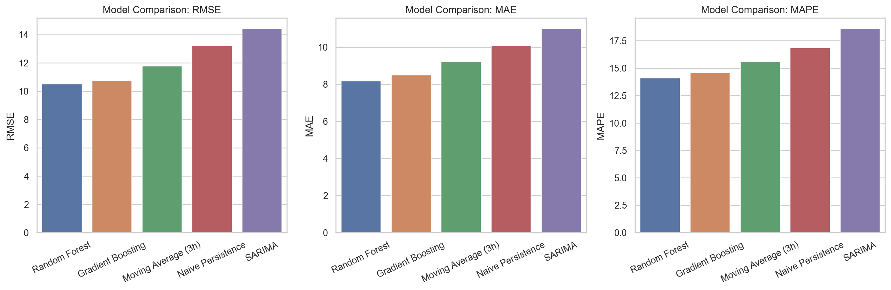
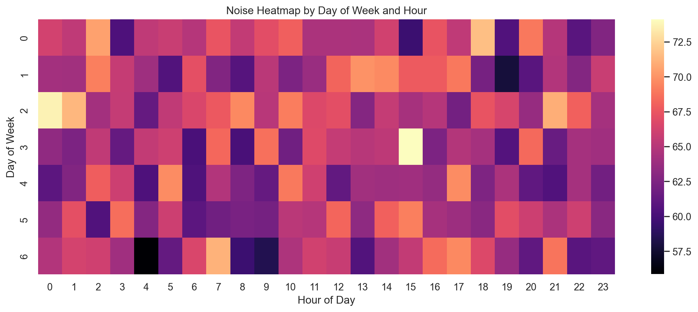
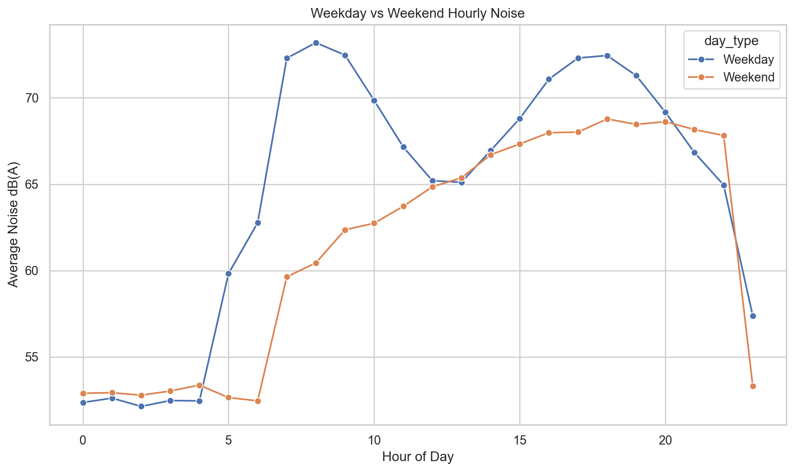
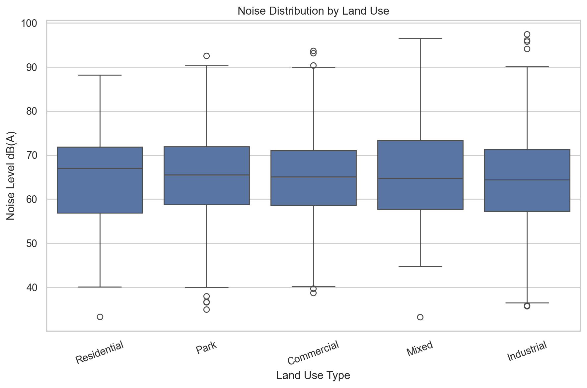
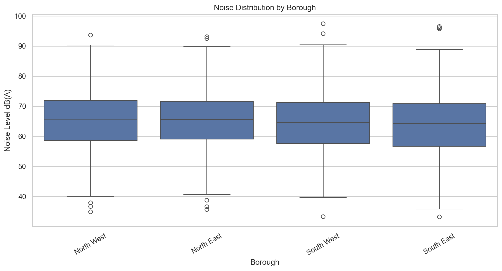
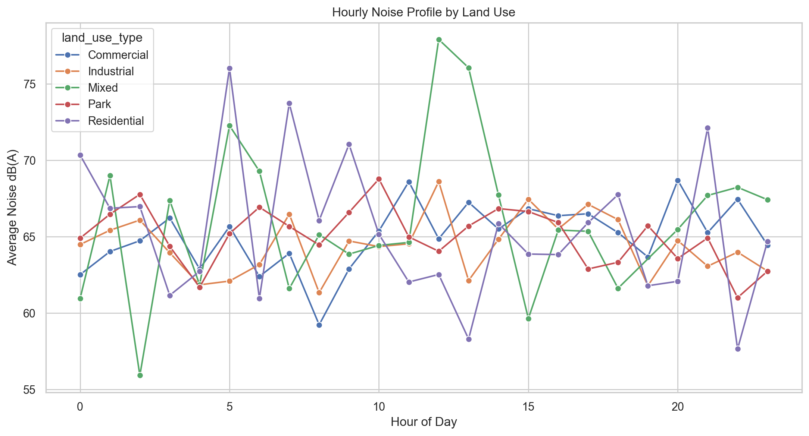
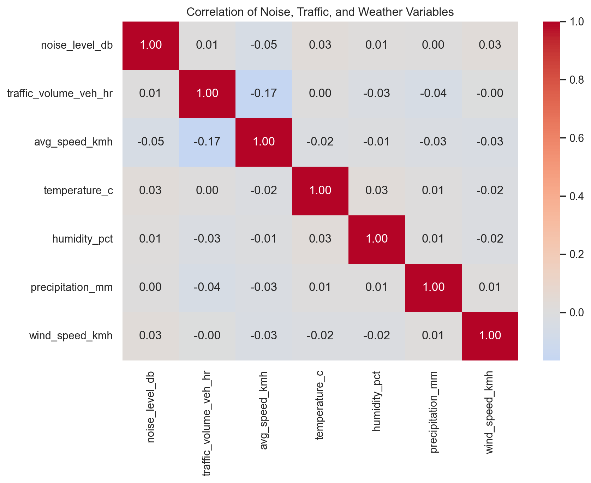

# 🔊 Urban Noise Analytics

**Predicting urban noise patterns using sensor data and machine learning.**
MSc Data Science Final Project, University of Greenwich

An end-to-end Python application that turns raw sensor-style noise readings into cleaned datasets, exploratory insights, model comparisons, future forecasts and an interactive Streamlit dashboard.

> **Note on data:** The project uses a **synthetic sensor-style dataset** (`urban_noise_levels.csv`) located around the **New York City area**, based on the sensor coordinates. It contains no personal data and is not an official noise monitoring record.

---

## 📌 Project Overview

| | |
|---|---|
| **Raw data** | 2,000 sensor observations · 50 sites in the New York City area · full year 2023 |
| **Processed data** | 1,994 hourly site-time records |
| **Models compared** | Naive Persistence, Moving Average (3h), Random Forest, Gradient Boosting, SARIMA |
| **Best model** | Random Forest (RMSE 10.52, MAE 8.18, MAPE 14.10) |
| **Forecast validation** | 43 sites · mean RMSE 12.29 |
| **Output** | Interactive Streamlit dashboard with filters, a site map and date-range forecasting |

---

## 🔄 Pipeline

```
Raw CSV  →  Data Pipeline  →  EDA  →  Modelling  →  Evaluation  →  Forecasting  →  Dashboard
            (clean, impute,    (plots,   (baselines,  (RMSE, MAE,   (SARIMA +      (Streamlit)
             feature-engineer)  maps)     RF, GB,      MAPE)         seasonal
                                          SARIMA)                    fallback)
```

1. **Data pipeline:** cleans raw readings, interpolates missing noise values, aggregates to hourly records and engineers time features (hour, day of week, weekend flag, lags, rolling averages).
2. **EDA:** hourly and daily profiles, weekday vs weekend comparison, distributions by land use and area, a day × hour heatmap, a correlation analysis and an interactive noise map.
3. **Modelling:** trains baseline, tree-based and time-series models using a chronological train/test split.
4. **Evaluation:** compares the models with RMSE, MAE and MAPE.
5. **Forecasting:** predicts future date ranges per site, falling back to an hourly seasonal profile when a site's history is too sparse for SARIMA.
6. **Dashboard:** explores everything interactively in Streamlit.

---

## 📊 Results

| Model | RMSE | MAE | MAPE |
|---|---|---|---|
| **Random Forest** | **10.52** | **8.18** | **14.10** |
| Gradient Boosting | 10.76 | 8.48 | 14.57 |
| Moving Average (3h) | 11.78 | 9.24 | 15.62 |
| Naive Persistence | 13.24 | 10.09 | 16.88 |
| SARIMA | 14.44 | 11.02 | 18.63 |



### Key findings
- **Random Forest performed best**, beating every baseline. Gradient Boosting was a close second.
- **Time patterns mattered more than location labels.** Noise peaked around **3 PM** and was quietest around **4 AM**. Differences between land-use types and areas were small.
- **SARIMA ranked last.** With sparse, irregular histories, feature-engineered tree models captured short-term patterns better than a per-site seasonal model.
- **Lag and rolling features** made the biggest difference to performance.

---

## 🔍 Exploratory Data Analysis

| Noise heatmap by day & hour | Weekday vs weekend |
|---|---|
|  |  |

| Noise by land use | Noise by area |
|---|---|
|  |  |

| Hourly profile by land use | Correlation heatmap |
|---|---|
|  |  |

---

## 🗂️ Project Structure

```
Urban-Noise-Pred-Project/
├── dashboard/
│   └── app.py                 # Streamlit dashboard
├── data/
│   ├── raw/                   # Raw input data
│   └── processed/             # Cleaned & model-ready datasets
├── notebooks/
│   └── 01_exploration.ipynb   # Exploratory notebook
├── outputs/
│   ├── figures/               # EDA plots, map, summaries
│   └── models/                # Trained models, metrics, predictions, forecasts
├── src/
│   ├── data_pipeline.py       # Cleaning, imputation, feature engineering
│   ├── eda.py                 # Exploratory analysis & plots
│   ├── models.py              # Baselines, Random Forest, Gradient Boosting, SARIMA
│   ├── evaluate.py            # RMSE / MAE / MAPE evaluation
│   ├── forecasting.py         # Future date-range forecasting
│   └── utils.py               # Paths & helpers
├── tests/                     # Pytest tests
├── urban_noise_levels.csv     # Synthetic raw dataset
└── requirements.txt
```

---

## 🚀 How to Run

```bash
# 1. Clone the repository
git clone https://github.com/s-asim-ahmed/Urban-Noise-Pred-Project.git
cd Urban-Noise-Pred-Project

# 2. Install dependencies
pip install -r requirements.txt

# 3. Run the pipeline step by step
python src/data_pipeline.py
python src/eda.py
python src/models.py
python src/evaluate.py
python src/forecasting.py

# 4. Launch the dashboard
streamlit run dashboard/app.py

# 5. Run the tests
pytest tests/
```

---

## 🛠️ Tech Stack

Python · Pandas · NumPy · Scikit-learn · Statsmodels · Matplotlib · Seaborn · Plotly · Folium · Streamlit · PyArrow · Joblib · Pytest

---

## ⚠️ Limitations & Future Work

- The dataset is synthetic and relatively small, so the findings show the method working rather than real-world noise conclusions.
- Sparse, irregular site histories limit how reliable long-range forecasts can be.
- Future work: real open noise datasets, denser monitoring, richer weather and traffic features, and deep learning models where the data volume justifies them.

---

## 👤 Author

**Asim Ahmed Syed**
MSc Data Science, University of Greenwich
[LinkedIn](https://www.linkedin.com/in/asim-ahmed-syed-903a9b318)
